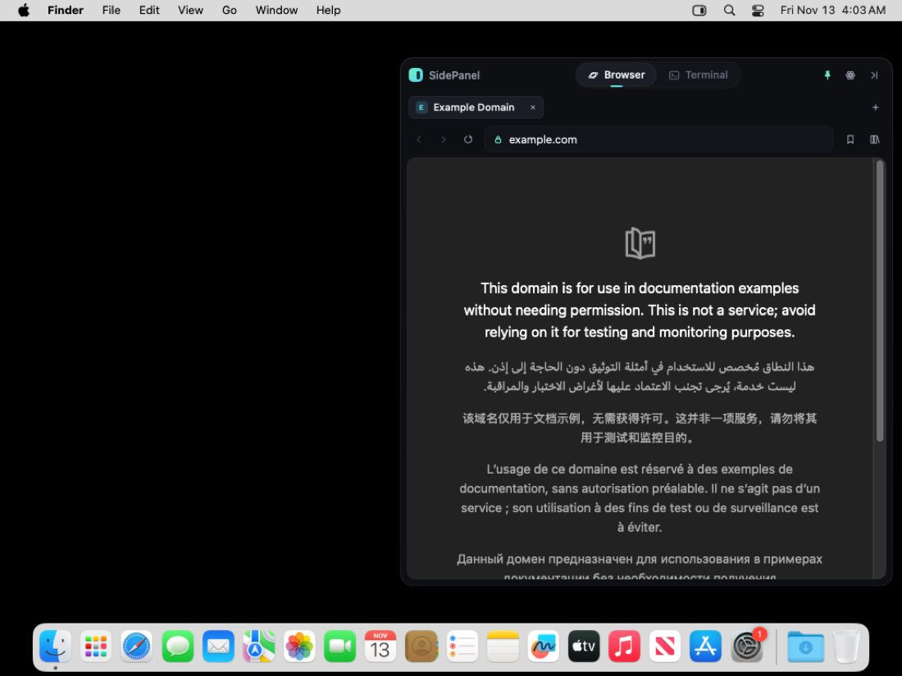
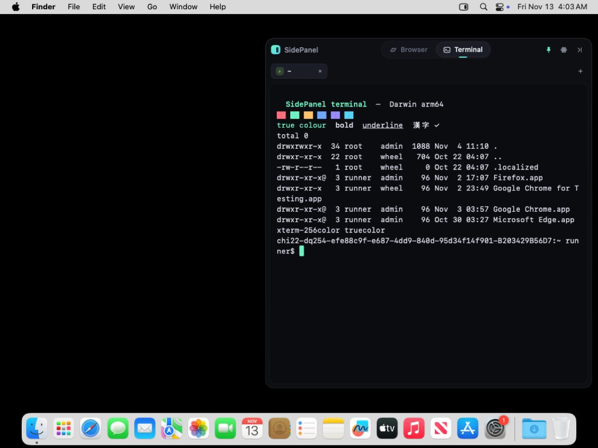
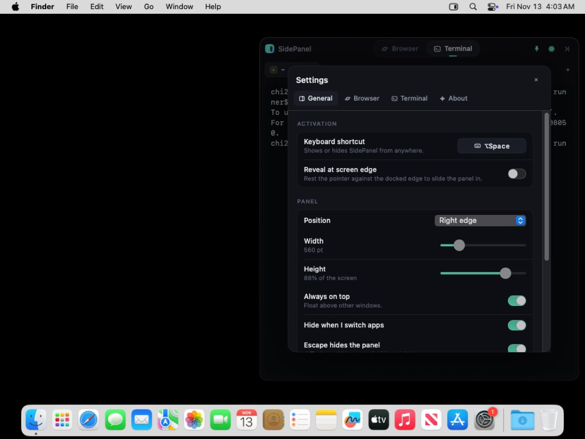

# SidePanel

A hidden, floating macOS panel with its own **web browser** and its own **terminal**.
Press a shortcut (default **⌥Space**) or push the pointer against the screen edge,
and the panel slides in. Press **Esc** and it's gone.

- **Browser:** an original interface over the system WebKit engine. It has tabs, a combined address and search bar with suggestions, back/forward/reload, bookmarks, history, downloads, page zoom, a start page and error pages. It never opens Safari or Chrome.
- **Terminal:** SidePanel's own xterm-compatible emulator, connected to a real PTY (`forkpty`) running your login shell. It supports multiple sessions, scrollback, 256-colour and true-colour, the alternate screen (vim, htop, less), mouse reporting, bracketed paste, IME input, selection and copy/paste, and drag-and-drop of files. It never opens Terminal.app or any other terminal.
- **Panel:** a background accessory app (no Dock icon). It has a customizable global hotkey and optional screen-edge reveal. You can dock it left, right or top-centre, or leave it wherever you drag it. It can be resized and pinned on top, it animates in and out, and it remembers the last section you used.

## Download

Get **`SidePanel-<version>.dmg`** from the repository's **Releases** page. Open it, drag **SidePanel** into **Applications**, and launch it from there. Then press **⌥Space** to show the panel. It's a single self-contained app (universal: Apple Silicon and Intel) that needs nothing else installed.

The installer window shows these steps too.

**First launch of an un-notarized build.** Until the project is signed with an Apple Developer ID (see below), macOS will warn that it can't verify the developer.
- **macOS 15 and later:** double-click SidePanel and choose **Done**. Then open **System Settings → Privacy & Security**, scroll down and click **Open Anyway**.
- **macOS 13–14:** right-click the app, choose **Open**, then **Open** again.

You only need to do this once.

## Screenshots

These were captured automatically by CI from the real app running on a macOS runner.

| Browser | Terminal | Settings |
|---|---|---|
|  |  |  |

## Project layout

```
Package.swift                 Swift Package (Swift 5.9+, macOS 13+)
Sources/CPTY/                 C shim: forkpty / TIOCSWINSZ / process info (async-signal-safe)
Sources/SidePanelCore/        Platform-independent engine (Foundation only)
  Terminal/                   TerminalEmulator (VT/xterm parser + screen), KeyEncoder, PTYProcess
  Browser/                    AddressResolver, search engines, bookmarks, history, suggestions
  Support/                    JSON persistence
Sources/SidePanel/            The macOS app
  App/                        entry point, AppDelegate, floating panel, hotkey, edge activation, menus
  Browser/                    WKWebView tabs, address field, start page, library, downloads
  Terminal/                   TerminalView (CoreText renderer + input), sessions, palette
  Settings/                   in-panel settings, shortcut recorder
  UI/                         theme, custom glyph set, tab strip, window chrome
Tests/SidePanelCoreTests/     Unit tests: emulator, key encoding, PTY, address bar, library
Packaging/                    Info.plist, entitlements, AppIcon.icns
scripts/                      build_app.sh, make_dmg.sh, generate_icon.py
.github/workflows/build.yml   Cloud build: tests on Linux + macOS, builds the .app and .dmg
```

The core is separate from the app so each feature can be developed and tested on its own. The terminal engine, PTY layer and browser logic have no AppKit dependency, and CI runs their tests on Linux as well as macOS.

There are no third-party dependencies. The app uses only Apple system frameworks: AppKit, SwiftUI, WebKit, Carbon (for the hotkey) and ServiceManagement (for launch at login).

## Cloud builds and releases

Every push runs **GitHub Actions** (`.github/workflows/build.yml`) on an Apple Silicon macOS runner. The workflow:
1. runs the unit tests on Linux and macOS,
2. builds a universal app,
3. launches it in each section and captures screenshots,
4. packages the DMG, which is attached to the run as an artifact.

To publish a release, push a tag such as `v1.0.1`, or run the workflow manually with **release** ticked. Either way, the DMG and a zipped app are published on the Releases page.

### Making it open with a plain double-click (Developer ID + notarization)

macOS opens apps without any warning only if Apple has issued the signing certificate and checked the app (notarization). Once you have an [Apple Developer Program](https://developer.apple.com/programs/) membership, add these **repository secrets** (Settings → Secrets and variables → Actions). Every build is then signed, notarized and stapled automatically, with no code changes:

| Secret | What it is |
|---|---|
| `MACOS_CERT_P12` | Your *Developer ID Application* certificate exported from Keychain Access as .p12, base64-encoded: `base64 -i cert.p12 \| pbcopy` |
| `MACOS_CERT_PASSWORD` | The password you chose when exporting the .p12 |
| `APPLE_ID` | Your Apple Account email |
| `APPLE_TEAM_ID` | Your 10-character Team ID (developer.apple.com → Membership) |
| `APPLE_APP_PASSWORD` | An app-specific password from appleid.apple.com → Sign-In and Security |

You can also set a repository *variable* `BUNDLE_ID`, for example `com.yourname.SidePanel`.

## Building locally

You don't need Xcode. Apple's free Command Line Tools are enough:

```sh
xcode-select --install          # once; installs swift, codesign, hdiutil

swift test                      # run the unit tests
scripts/build_app.sh            # → dist/SidePanel.app (arm64, ad-hoc signed)
scripts/make_dmg.sh             # → dist/SidePanel-1.0.0.dmg
open dist/SidePanel.app
```

To build a universal binary, run `ARCHS="arm64 x86_64" scripts/build_app.sh`.

If you prefer to work in Xcode, it can open `Package.swift` directly.

To change the icon, edit and run `python3 scripts/generate_icon.py`, which needs Pillow. It regenerates `Packaging/AppIcon.icns`.

## Signing and notarizing on your own Mac

```sh
# once: store notarization credentials in your keychain
xcrun notarytool store-credentials sidepanel-notary \
    --apple-id you@example.com --team-id TEAMID --password abcd-efgh-ijkl-mnop

export SIGN_IDENTITY="Developer ID Application: Your Name (TEAMID)"   # see: security find-identity -v -p codesigning
ARCHS="arm64 x86_64" BUNDLE_ID=com.yourname.SidePanel scripts/build_app.sh   # hardened runtime + timestamp
NOTARY_PROFILE=sidepanel-notary scripts/make_dmg.sh   # notarizes + staples the app, then the DMG
```

The app is **not sandboxed**, and this is deliberate. A terminal has to run arbitrary programs, which App Sandbox forbids. So SidePanel is distributed with Developer ID and a DMG, not through the Mac App Store. Its entitlements (`Packaging/SidePanel.entitlements`) only cover camera, microphone and location for websites, plus Apple Events for terminal commands.

## Using SidePanel

| Action | Shortcut |
|---|---|
| Show / hide panel | ⌥Space (change it in Settings) |
| Hide | Esc, or ⇧Esc (always works, even inside vim) |
| Browser / Terminal | ⌘1 / ⌘2 |
| New tab or session / close | ⌘T / ⌘W |
| Next / previous tab | ⌃Tab / ⌃⇧Tab (also ⌘⇧] / ⌘⇧[) |
| Go to tab 1–9 | ⌥⌘1 … ⌥⌘9 |
| Address bar | ⌘L (↑/↓ choose a suggestion, ⌘Return opens in a new tab) |
| Back / forward / reload | ⌘[ / ⌘] / ⌘R |
| Bookmark page / Library / Downloads | ⌘D / ⌘Y / ⌥⌘L |
| Zoom page or terminal font | ⌘+ / ⌘− / ⌘0 |
| Clear terminal | ⌘K |
| Scroll terminal history | trackpad, ⇧PageUp/PageDown, ⌘↑ / ⌘↓ |
| Line start / end / delete line (terminal) | ⌘← / ⌘→ / ⌘⌫ |
| Word left / right (terminal) | ⌥← / ⌥→ |
| Pin on top | ⇧⌘P |
| Settings | ⌘, |

More behaviour:
- **Moving and resizing.** Drag the header to move the panel; this switches it to "Where I leave it". Double-click the header to dock it again. Drag the panel's inner edges to resize it.
- **Menu bar icon.** Click it to toggle the panel. Right-click it for Settings and Quit.
- **Terminal tricks.** Drop files onto the terminal to paste their shell-quoted paths. A new session opens in the current session's working directory.

## How the pieces work

- **PTY.**
  - `sp_pty_spawn` calls `forkpty`. In the child it resets every signal disposition (GUI apps ignore SIGPIPE), closes inherited descriptors and `execve`s your login shell as `-zsh`.
  - The parent reads the master side with a `DispatchSource` and writes on a serial queue, so large pastes never block the UI.
  - Window resizes go through `TIOCSWINSZ`, so programs receive `SIGWINCH`.
- **Emulator.**
  - The parser is a byte-level VT500-style state machine with streaming UTF-8 decoding.
  - It handles CSI, ESC, OSC (window title, working directory), DCS pass-through and DEC line-drawing.
  - It supports scroll regions, origin and insert modes, wide and combining characters, alternate screen 47/1047/1049, cursor styles, and device status and attribute replies.
  - Scrollback is bounded, and lines move in and out of scrollback when the terminal is resized.
- **Renderer.**
  - Each frame draws background runs, the selection, text runs in the monospaced system font, then the cursor.
  - Non-ASCII glyphs are drawn cell by cell, so font fallback can't push the rest of a line off the grid.
- **Browser.** Each tab owns a `WKWebView`, and SwiftUI hosts the existing view without recreating it. Downloads go through `WKDownload` into `~/Downloads`. Bookmarks and history are stored as JSON in `~/Library/Application Support/SidePanel/`.
- **Hotkey.** Registered with Carbon `RegisterEventHotKey`, so it needs no Accessibility permission. Edge activation polls the pointer position, so it needs no permissions either.
